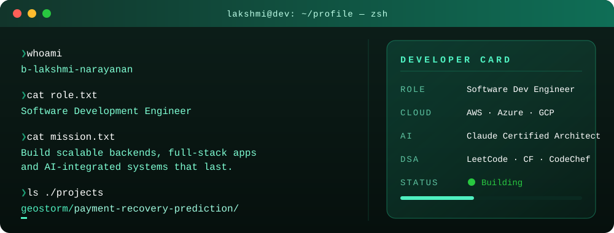
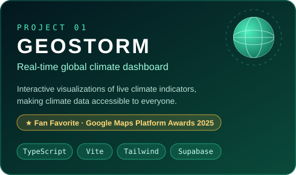
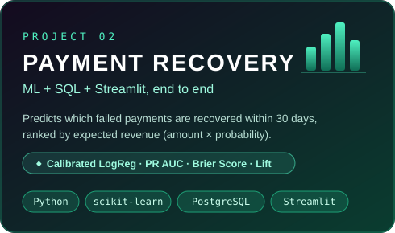

    

    

  

  
 
💻 whoami

  
 
🚀 Featured Projects

 

 

   

 
🧰 Arsenal

  &nbsp;&nbsp;&nbsp;     &nbsp;&nbsp;&nbsp; 

  

🎯 Domain	⚙️ Stack
Languages	Java Python JavaScript TypeScript
Frontend	React Next.js Three.js
Backend	Node.js Django
Databases	MongoDB PostgreSQL
Cloud	AWS Azure GCP
AI / ML	Claude scikit-learn · LLM-integrated systems

 
📈 Live Stats

      

🐍 Contribution Snake

 <picture> <source media="(prefers-color-scheme: dark)" srcset="https://raw.githubusercontent.com/lakshmi22-2007/lakshmi22-2007/output/github-snake-dark.svg"/>  </picture> 
 
🎖️ Certifications Unlocked

        

  

 &nbsp;&nbsp;  

🔭 Currently
yaml
building:   "AI-integrated full-stack systems"
learning:   "Cloud architecture & agentic AI"
practicing: "DSA on LeetCode · Codeforces · CodeChef"
open_to:    "Backend / Full-stack / AI engineering roles"

  

 

